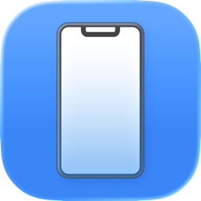

<div align="center">

# MacPhone

Real Bluetooth LE devices in the Android emulator on your Mac. MacPhone connects to the device over the Mac's built-in radio and publishes it inside the emulator, so the app you are testing scans, connects and talks to it like on a phone. It also runs your Android emulators and Xcode simulators from one window.

[](https://github.com/jx-grxf/MacPhone/actions/workflows/ci.yml)
[](https://github.com/jx-grxf/MacPhone/releases/latest)




[Download](https://github.com/jx-grxf/MacPhone/releases/latest) · [How it works](#how-it-works) · [Architecture](ARCHITECTURE.md) · [Bridge](bridge/README.md) · [Project page](https://johannesgrof.me/projects/macphone/)

</div>

> [!TIP]
> Built for the moment your Android app talks to a BLE sensor, lock or wearable, and you want to debug it in the emulator instead of on a phone on your desk.

## What it does

**Bluetooth bridge**

- Connects to a real Bluetooth LE device with CoreBluetooth and mirrors its services, characteristics and advertisement into the Android emulator.
- The app under test uses the normal Android `BluetoothGatt` API. No library to add, no code path that only exists for the emulator.
- Reads, writes and notifications go both ways. Subscriptions are renewed after every reconnect.
- No USB Bluetooth dongle. The Mac's own radio does the talking.
- A demo device (battery service plus an echo characteristic) for trying the path without hardware.

**Android emulators**

- Creates emulators with current Google images (Android 14 to 17), downloading image and emulator with `sdkmanager`.
- Start, stop, cold start, start without a window, erase, delete.
- Install an `.apk` by dropping it on a running emulator, open a URL or deep link, take a screenshot, switch light and dark mode.
- Finds the SDK in Android Studio's folder, `ANDROID_HOME` or the Homebrew command-line tools.

**Xcode simulators**

- Every simulator grouped by iPhone, iPad, Apple Watch, Apple TV and Vision, with search and a running-only filter.
- Create simulators for any installed runtime and download missing runtimes through Xcode.
- Install an `.app` by dropping it, open URLs, screenshots, appearance, a clean 9:41 status bar, rename, duplicate, erase, delete.

**Setup**

- Checks Python, the bridge runtime, Java, the Android tools and Xcode, and installs what is missing with one click.

## How it works

<p align="center">
  
</p>

1. MacPhone connects to the device as a CoreBluetooth central and reads its GATT table.
2. It hands the table to a small Python process over `127.0.0.1`. The socket only accepts a client that presents a token MacPhone generates at launch.
3. That process uses [Bumble](https://github.com/google/bumble) to publish the same services, name and manufacturer data on netsim, the emulator's virtual Bluetooth controller.
4. Your app sees an ordinary BLE peripheral. Every read, write and subscription is forwarded to the real device.

### What works and what doesn't

| | |
|---|---|
| Bluetooth LE peripherals (sensors, locks, wearables, beacons, your own firmware) | Works |
| Devices that secure traffic in their own protocol | Works |
| Devices that require Bluetooth pairing or link-layer encryption | Does not work: the mirror sits above the link layer |
| Bluetooth Classic (speakers, headsets, car audio) | Does not work: macOS exposes only BLE to apps |
| iOS Simulator | Does not work: the simulator has no Bluetooth |

Connect from your app or a BLE client such as nRF Connect. The Android Settings pairing screen is for Classic devices and will hang.

## Install

Download the DMG from the [latest release](https://github.com/jx-grxf/MacPhone/releases/latest), drag MacPhone to Applications and open it. Updates arrive through Sparkle.

The current builds are not notarized. On first launch, open System Settings → Privacy & Security and choose Open Anyway.

## Requirements

- macOS 14 or later, Apple silicon
- For the bridge: Python 3.11 or later (Setup installs it with Homebrew) and an Android emulator with netsim, which every current emulator has
- For simulators: Xcode

## Development

```bash
brew install xcodegen
./script/build_and_run.sh
```

Tests:

```bash
./script/prepare_xcode_project.sh
xcodebuild -project MacPhone.xcodeproj -scheme MacPhone -destination 'platform=macOS' test
```

Toolchain and release rules are in [AGENTS.md](AGENTS.md). The bridge can be run and tested on its own, see [bridge/README.md](bridge/README.md).

## Similar tools

[BLEForEmulator](https://github.com/engelon/BLEForEmulator) takes the same idea the other way round: the Android app links a library that talks to a Mac helper. MacPhone needs no change to the app, at the cost of a Python runtime on the Mac.

## License

MIT, see [LICENSE](LICENSE).
